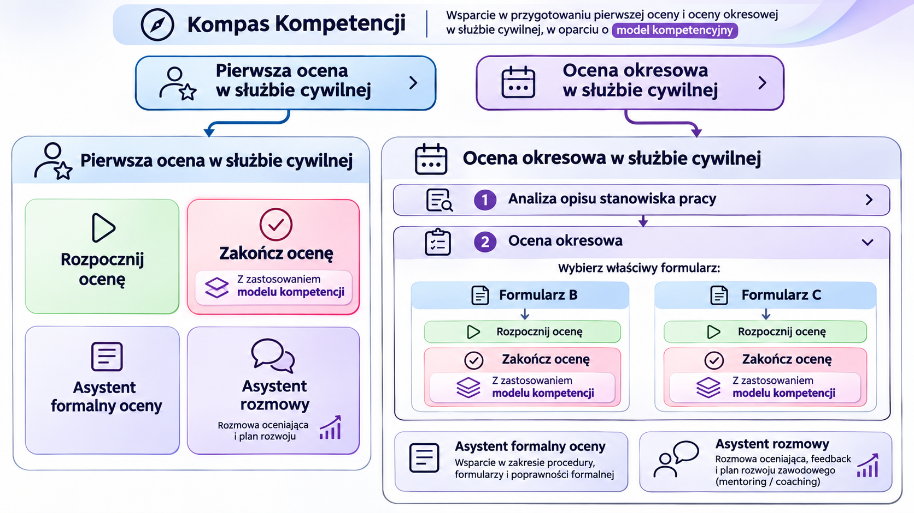

# Kompas Kompetencji

Prototyp aplikacji webowej wspierającej przełożonych w służbie cywilnej w przeprowadzeniu **pierwszej oceny** i **oceny okresowej** pracowników — w oparciu o model kompetencji, obserwowalne zachowania i asystenta AI. Projekt na HackNation 2026 (wyzwanie Ministerstwa Cyfryzacji).

> Status: etap specyfikacji. Kod aplikacji powstaje w `apps/`, `functions/` i `packages/`.



## Najważniejsze założenia
- **Dwie ścieżki:** pierwsza ocena (skala 3/5/7) oraz ocena okresowa na arkuszu B lub C (skala 1/3/5/7/9), z analizą opisu stanowiska pracy (OSP).
- **Model kompetencji MC:** 14 kompetencji, 49 wskaźników behawioralnych, 5 poziomów opisanych konkretnymi zachowaniami.
- **Human-in-the-loop:** system sugeruje poziom na podstawie wskaźników, ocenę zawsze wybiera przełożony. Wynik (pozytywna/negatywna) liczony deterministycznie w kodzie, zgodnie z rozporządzeniami z 2015 i 2016 r.
- **Asystent Formalny (RAG):** odpowiada wyłącznie na podstawie aktów prawnych i poradników KPRM, zawsze z cytatem; brak informacji → odmowa.
- **Asystent Rozmowy:** agenda rozmowy, feedback oparty na faktach, szkice uzasadnienia i IPRZ do weryfikacji przez przełożonego.
- **Panel HR:** statusy i terminy ocen bez dostępu do ich treści (RODO).
- **Eksport PDF** w układzie urzędowych arkuszy.

## Technologie
React + Vite + TypeScript · Tailwind v4 · Firebase (Auth, Firestore, Cloud Functions, Hosting) · Gemini 3.5 Flash-Lite (Gemini API, płatny tier) · BM25 (minisearch) · @react-pdf/renderer · Vitest.

## Struktura repozytorium
| Katalog | Zawartość |
| --- | --- |
| `docs/` | Specyfikacja: wymagania, reguły prawne, AI/RAG, dane demo, schemat Firestore, style guide, `tokens.css` |
| `knowledge/sources/` | Źródła: ustawa o służbie cywilnej (t.j. Dz. U. 2026 poz. 590), rozporządzenia z 2015 i 2016 r., poradniki KPRM, wzory arkuszy, model kompetencji |
| `demo-data/osp/` | Trzy opisy stanowisk pracy MC używane w scenariuszach demo |

## Uruchomienie lokalne

Wymagania: Node 22, Java (emulatory Firebase), Python 3 + `pypdf` (tylko do przebudowy indeksu RAG).

```bash
npm install
npm run emulators                 # Auth + Firestore + Functions (projekt demo-kompas)
# w drugim terminalu:
VITE_FIREBASE_USE_EMULATOR=true VITE_FIREBASE_PROJECT_ID=demo-kompas npm run dev
```

Na ekranie logowania kliknij **„Przywróć dane demo”**, a potem jeden z przycisków „Wejdź jako…”. Asystenci AI na emulatorze wymagają klucza w `functions/.secret.local` (`GEMINI_API_KEY=…`).

| Polecenie | Co robi |
| --- | --- |
| `npm test` | testy domeny (wynik, sugestia, terminy, parser OSP, kodek), funkcji (RAG, walidacja cytatów) i UI/PDF |
| `npm run test:rules` | testy reguł Firestore na emulatorze |
| `npm run typecheck` | TypeScript we wszystkich pakietach |
| `npm run kb:build` | przebudowa `competencies.json`, profili demo OSP i indeksu RAG z `knowledge/sources/` |
| `GEMINI_API_KEY=… npm run eval:assistant -w functions` | zestaw testów asystenta na żywym modelu (po każdej zmianie promptu lub indeksu) |
| `npx tsx functions/scripts/smoke-emulator.ts` | test end-to-end na emulatorach (reguły, `completeEvaluation`, trigger trackingu) |

## Wdrożenie (Firebase, plan Blaze)

```bash
npx firebase functions:secrets:set GEMINI_API_KEY   # klucz z Google AI Studio (projekt z płatnym tierem)
npm run deploy                                      # build web + functions, reguły, indeksy, hosting
GOOGLE_APPLICATION_CREDENTIALS=<klucz-konta-serwisowego>.json npm run seed:prod
```

## Dokumentacja
1. [Kontekst i wymagania](docs/01_context_and_requirements.md)
2. [Logika domenowa i przepisy](docs/02_domain_logic_and_rules.md)
3. [Asystenci AI i RAG](docs/03_ai_assistants_and_rag_spec.md)
4. [Dane testowe i formularze](docs/04_test_data_osp_and_forms.md)
5. [Struktura Firestore](docs/firebase/firestore_structure.md)
6. [Style guide](docs/STYLE_GUIDE.md)

## Bezpieczeństwo i RODO
Prototyp działa na danych fikcyjnych. Przed wdrożeniem produkcyjnym wymagane są m.in.: pseudonimizacja treści wysyłanych do modelu językowego lub model on-premise (Bielik / PLLuM), umowa powierzenia przetwarzania oraz integracja uwierzytelniania z systemami urzędu. Szczegóły: [01 § 9.2](docs/01_context_and_requirements.md).
